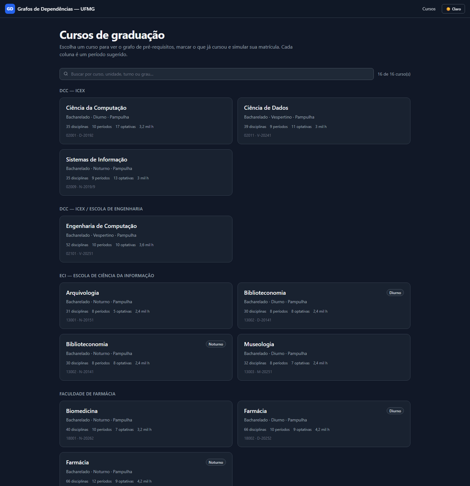
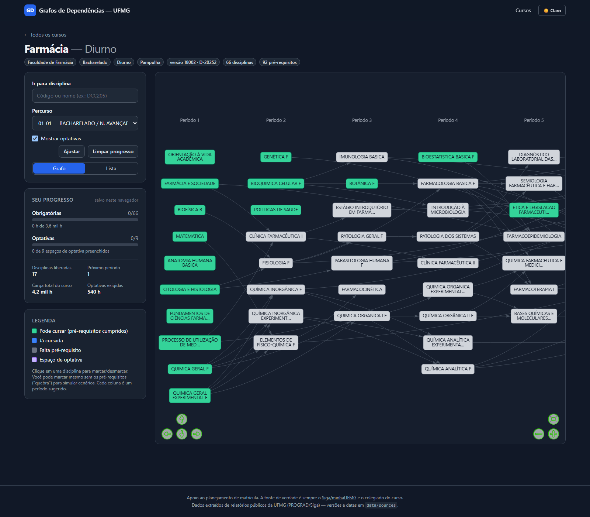

# Grafos de Dependências — UFMG

Visualizador dos **pré-requisitos** das disciplinas dos cursos de graduação da UFMG.
Cada coluna do grafo é um período sugerido; cada nó é uma disciplina; cada seta indica
"esta disciplina exige aquela". Dá para marcar o que você já cursou (fica azul), o que já
está liberado (verde) e o que ainda está bloqueado (cinza), inclusive simulando
"quebra de pré-requisito".

**Site:** https://herculest619.github.io/GrafosDependenciasUFMG/

> Projeto derivado do [GrafosDependenciasUFOP](https://github.com/Herculest619/GrafosDependenciasUFOP)
> (cursos de Engenharia de Computação/Produção/Sistemas do ICEA-UFOP), reescrito para os cursos da UFMG.

## Telas

Catálogo de cursos:



Grafo de um curso (Engenharia de Computação):



## Estado atual

**25 cursos** publicados (de ~100 da UFMG), cobrindo 8 unidades/setores:

| Unidade             | Curso                                       | Versão curricular      | Períodos | Disciplinas | Pré-requisitos | Optativas    | Carga total |
| ------------------- | ------------------------------------------- | ---------------------- | -------- | ----------- | -------------- | ------------ | ----------- |
| DCC — ICEx          | Ciência da Computação                       | 02001 · D-20192        | 10       | 35          | 25             | 11–17 slots  | 3.240 h     |
| DCC — ICEx          | Sistemas de Informação                      | 02009 · N-2019/9       | 9        | 35          | 16             | 13 slots     | 3.000 h     |
| DCC — ICEx / Eng.   | Engenharia de Computação                    | 02101 · V-20251        | 10       | 52          | 41             | 10 slots     | 3.600 h     |
| DCC — ICEx          | Ciência de Dados                            | 02011 · V-20241        | 9        | 39          | 36             | 11 slots     | 3.000 h     |
| ICEx — Física       | Física — Bacharelado                        | fonte legada           | 7        | 31          | 38             | não mapeadas | —           |
| ICEx — Física       | Física — Licenciatura (diurno)              | fonte legada           | 9        | 41          | 49             | não mapeadas | —           |
| ICEx — Física       | Física — Licenciatura (noturno)             | fonte legada           | 10       | 41          | 48             | não mapeadas | —           |
| ICEx — Física       | Física — Bacharelado (matriz 2013/1)        | PDF em `data/archives` | 7        | 30          | 32             | 13 slots     | 2.400 h     |
| ICEx — Física       | Física — Licenciatura Noturno (matriz 2018) | PDF em `data/archives` | 9        | 35          | 33             | 12 slots     | 2.805 h     |
| IGC — Geociências   | Geografia — Licenciatura (matutino)         | 04004 · M-20271        | 10       | 43          | 27             | 7 slots      | 3.225 h     |
| IGC — Geociências   | Geografia — Licenciatura (noturno)          | 04004 · N-20271        | 10       | 43          | 27             | 7 slots      | 3.225 h     |
| IGC — Geociências   | Turismo                                     | 04003 · D-20221        | 8        | 25          | 3              | 13 slots     | 2.550 h     |
| Medicina            | Medicina                                    | 16003 · I-20212        | 12       | 79          | 117            | 7 slots      | 7.755 h     |
| ICA (Montes Claros) | Engenharia de Alimentos                     | 24003 · D-20251        | 10       | 55          | 22             | 9 slots      | 3.600 h     |
| ICA (Montes Claros) | Zootecnia                                   | 24006 · D-20261        | 10       | 50          | 20             | 13 slots     | 3.600 h     |
| ICA (Montes Claros) | Aquacultura                                 | 21001 · D2023-1        | 10       | 53          | 19             | 7 slots      | 3.600 h     |
| Farmácia            | Farmácia — Diurno                           | 18002 · D-20252        | 10       | 66          | 92             | 9 slots      | 4.170 h     |
| Farmácia            | Farmácia — Noturno                          | 18002 · N-20252        | 12       | 66          | 92             | 9 slots      | 4.170 h     |
| Farmácia            | Biomedicina                                 | 18001 · N-20262        | 10       | 40          | 48             | 7 slots      | 3.210 h     |
| ECI                 | Biblioteconomia — Diurno                    | 13002 · D-20141        | 8        | 30          | 3              | 8 slots      | 2.400 h     |
| ECI                 | Biblioteconomia — Noturno                   | 13002 · N-20141        | 8        | 30          | 3              | 8 slots      | 2.400 h     |
| ECI                 | Arquivologia                                | 13001 · N-20151        | 8        | 31          | 6              | 5 slots      | 2.400 h     |
| ECI                 | Museologia                                  | 13003 · M-20251        | 8        | 32          | 8              | 7 slots      | 2.400 h     |
| FAE                 | Pedagogia — Diurno                          | 14006 · D-20191        | 9        | 41          | 0              | 13 slots     | 3.240 h     |
| FAE                 | Pedagogia — Noturno                         | 14006 · N-20191        | 9        | 41          | 0              | 13 slots     | 3.240 h     |

A UFMG tem **100 cursos de graduação**. Os dados de matriz curricular são publicados
curso a curso (não existe API pública unificada), então a cobertura cresce de forma
incremental — veja [Adicionar um curso](#adicionar-um-curso) e
[Cobertura e próximos passos](#cobertura-e-próximos-passos).

Observações sobre os dados:

-   Pedagogia **não tem pré-requisitos** na matriz oficial (0 arestas é o dado real);
-   cursos com vários percursos (Farmácia 3, Biblioteconomia 5, Pedagogia 6, Museologia 2)
    abrem no percurso padrão e permitem alternar na página do curso;
-   os 3 cursos de Física "fonte legada" não têm carga horária nem optativas mapeadas;
-   as duas matrizes de Física em `data/archives` são versões antigas **com** carga horária
    e pré-requisitos (úteis para quem está sob currículo antigo);
-   os **espaços de optativa são distribuídos automaticamente** entre as colunas dos
    períodos (abaixo das disciplinas), priorizando os semestres mais vazios — não existe
    mais uma coluna "Optativas" separada no fim do grafo.

O parser entende **três** formatos de documento:

-   **"Relatório de versão curricular"** (Siga) — uma linha por percurso dentro de cada
    período (DCC, Farmácia, ECI, FAE);
-   **"Relatório de percurso curricular"** (Siga) — um percurso por documento, colunas
    fixas (Sistemas de Informação e Ciência de Dados);
-   **"Estrutura curricular"** (PDFs mais antigos, ex. Física 2013/2018) — blocos por
    período com coluna de pré-requisito e grupos de optativas (G1/G2/G9).

Também trata os artefatos comuns da extração: cabeçalhos/rodapés colados nas linhas,
nomes e listas de pré-requisitos quebrados em duas linhas, blocos duplicados na virada
de página, identificadores de percurso não numéricos (`R-01`, `02-01`) e a coluna de
grupo com identificador completo (`13002-D-20141-1`).

## Como funciona

```
data/archives/*.pdf        PDFs enviados manualmente (inbox de documentos)
data/sources/**            texto extraído dos relatórios oficiais (Siga/PROGRAD/Estruturas)
        │  scripts/build-data.mjs  (parseSigaReport | parseEstruturaCurricular | legado)
        ▼
public/data/courses.json          catálogo (manifesto)
public/data/courses/<slug>.json   um arquivo por curso (carregado sob demanda)
        │  fetch em tempo de execução
        ▼
src/views/CatalogView.vue         catálogo com busca
src/views/CourseView.vue          grafo + progresso do curso
src/core/graph.mjs                regras puras: disponibilidade, cargas horárias, slots
```

### Modelo de dados (schema v2)

`public/data/courses.json`

```json
{
    "schemaVersion": 2,
    "generatedAt": "2026-11-05T...",
    "courses": [
        {
            "id": "ciencia-da-computacao",
            "name": "Ciência da Computação",
            "unit": "DCC — ICEX",
            "shift": "Diurno",
            "degree": "Bacharelado",
            "curriculum": "02001 · D-20192",
            "source": { "kind": "siga-versao-curricular", "url": "https://..." },
            "stats": { "disciplines": 58, "edges": 84, "periods": 10, "optionalSlots": 11 },
            "file": "data/courses/ciencia-da-computacao.json"
        }
    ]
}
```

`public/data/courses/<slug>.json`

```json
{
    "schemaVersion": 2,
    "id": "ciencia-da-computacao",
    "meta": { "...": "mesmos campos do manifesto" },
    "disciplines": {
        "DCC205": {
            "code": "DCC205",
            "name": "Estruturas de Dados",
            "type": "DIG",
            "credits": 4,
            "hours": { "total": 60, "theory": 45, "practice": 15 },
            "prereqs": ["DCC204"]
        }
    },
    "percursos": [
        {
            "id": "01-01",
            "name": "NÚCLEO COMUM / NÚCLEO AVANÇADO / NÚCLEO GERAL",
            "periods": [{ "number": 1, "codes": ["DCC203", "..."] }],
            "optionalSlots": [
                { "id": "OPT-01-01-01", "label": "Optativa 1", "hours": 60, "group": "Optativas" }
            ],
            "summary": {
                "obligatoryHours": { "min": 2040, "max": 2040 },
                "optionalHours": { "min": 660, "max": 780 },
                "complementaryHours": { "min": 0, "max": 0 },
                "freeHours": { "min": 60, "max": 180 },
                "totalHours": 3240
            }
        }
    ]
}
```

Decisões de modelagem:

-   **Slots de optativa**: as optativas não são pré-requisito de nada e o aluno escolhe quais
    cursar, então o grafo mostra apenas "Optativa 1, Optativa 2, …" (sem arestas), calculados
    a partir da carga horária mínima de optativas do percurso (mínima ÷ 60 h).
-   **Percurso**: quando a versão curricular permite mais de um percurso (ex.: BCC tem
    `01-01` Núcleo Comum e `01-02` Núcleo Avançado), a página permite alternar.
-   **Progresso** fica no `localStorage`, separado por curso:
    `grafos-ufmg:v3:<slug>`.

## Como rodar e testar localmente

Pré-requisitos: **Node.js 20+** (o projeto usa `node --test`) e npm.

```sh
# 1) instalar dependências (só na primeira vez)
npm install

# 2) subir o servidor de desenvolvimento
npm run dev
```

Abra **http://localhost:5173/GrafosDependenciasUFMG/** — atenção ao caminho com o nome do
repositório: o Vite está configurado com `base: '/GrafosDependenciasUFMG/'` por causa do
GitHub Pages. Abrir só `http://localhost:5173/` mostra página em branco.

A primeira execução pode demorar ~20 s (otimização de dependências do Vite); depois o hot
reload é imediato. Se a porta 5173 estiver ocupada: `npm run dev -- --port 5200`.

O que deve aparecer:

1. catálogo com os cursos publicados (hoje: Física ×3, Ciência da Computação, Sistemas de
   Informação, Engenharia de Computação, Ciência de Dados);
2. ao abrir um curso, o grafo com uma coluna por período, nós cinza/verde/azul e os slots
   "Optativa 1..N" na última coluna;
3. clique em um nó para marcar/desmarcar — o progresso fica em `localStorage` e é salvo por
   curso (sobrevive a recarregar a página).

Testar o build de produção (é o que o GitHub Pages serve):

```sh
npm run build      # gera dist/
npm run preview    # http://localhost:4173/GrafosDependenciasUFMG/
```

Rodar as verificações antes de commitar:

```sh
npm run check      # testes + validação dos dados + checagem dos componentes
npm run lint
```

O `npm run check` roda três verificações independentes:

1. `npm test` — 66 testes (`node --test`) das regras de grafo/progresso, dos parsers
   (incluindo regressão sobre os 13 relatórios oficiais do Siga e os 2 PDFs de estrutura
   curricular de Física), da conversão para JSON v2 e da integridade dos dados publicados;
2. `npm run data:validate` — IDs duplicados, arestas órfãs, ciclos, pré-requisito em
   período posterior, faixas de carga horária e divergência entre o manifesto e os JSONs;
3. `npm run check:sfc` — compila os componentes Vue (`@vue/compiler-sfc`) e confere os
   imports relativos, sem depender do Vite.

Dicas de diagnóstico:

-   **página em branco** → confira a URL com `/GrafosDependenciasUFMG/`;
-   **link direto para um curso** (ex.: `/curso/ciencia-da-computacao`) → o build copia
    `dist/index.html` para `dist/404.html`; é esse fallback que faz o vue-router resolver a
    rota no GitHub Pages (`npm run build` já executa `scripts/copy-404.mjs`);
-   **erro 404 em `data/courses.json`** → rode `npm run data:build` (os JSONs de `public/data`
    são versionados, mas essa é a forma de regenerar);
-   **aviso de `esbuild`/`npm install`** em ambientes restritos → `npm install --ignore-scripts`;
-   **quer inspecionar uma fonte de dados** → `node scripts/inspect-source.mjs data/sources/dcc/bcc.txt`.

No CI (`.github/workflows/deploy.yml`) esses passos rodam antes do build e do deploy no
GitHub Pages, junto com o `lint`.

Scripts de dados:

```sh
npm run data:build      # data/sources/**.txt -> public/data/**
npm run data:validate   # integridade dos JSONs gerados (IDs, arestas, ciclos, cargas)
npm run data:fetch      # baixa o PDF do Siga e extrai o texto (precisa de pdftotext)
```

## Adicionar um curso

1. Baixe o relatório **"Versão Curricular"** (ou **"Percurso Curricular"**) do curso no Siga
   (minhaUFMG → Relatórios) ou num site de unidade que publique o PDF.
2. Extraia o texto preservando o layout de linhas:
    ```sh
    pdftotext -layout relatorio.pdf data/sources/dcc/novo-curso.txt
    ```
    (ou `npm run data:fetch -- --url <url-do-pdf> --out data/sources/.../*.txt`)
3. Registre a origem: em `data/sources/sources.json` (uma entrada só) ou num
   `data/sources/<unidade>/index.json` (formato usado nas unidades com vários cursos —
   veja `data/sources/farmacia/index.json`).
4. Inclua o arquivo em `COURSES` no topo de `scripts/build-data.mjs` (unidade e campus
   vêm de `UNIT_DEFAULTS`; nome, grau e turno são lidos do próprio relatório). O `kind`
   escolhe o parser: `siga`, `estrutura` (PDFs antigos com coluna de pré-requisito) ou
   `legacy` (JSON do projeto original).
5. Rode `npm run data:build && npm run data:validate`.
6. Abra um PR — o GitHub Actions roda `npm run check` e faz o deploy.

> PDFs enviados manualmente podem ficar em `data/archives/`; o texto extraído vai para
> `data/sources/<unidade>/` e a origem é registrada no `index.json` da unidade. Foi assim
> que entraram as matrizes antigas de Física (2013/1 e 2018).

## Cobertura e próximos passos

A UFMG tem ~100 cursos de graduação e **não existe API pública única** com as matrizes:
o dado autoritativo é gerado no Siga (autenticado). O levantamento de fontes está em
[docs/RELATORIO_FONTES_UFMG.md](docs/RELATORIO_FONTES_UFMG.md). Resumo do que já foi
varrido:

-   **DCC** — 4 cursos publicados (relatórios no site da unidade);
-   **Farmácia** — 3 cursos publicados (Farmácia diurno/noturno e Biomedicina), 17 PDFs
    avaliados e as versões antigas descartadas;
-   **ECI** — Biblioteconomia (diurno/noturno), Arquivologia e Museologia; 8 PDFs avaliados;
-   **FAE** — Pedagogia (diurno/noturno); Educação do Campo e FIEI **não publicam** matriz
    no formato do Siga (FIEI bloqueia acesso automatizado — respeitado);
-   **IGC** — Geografia (licenciatura matutino/noturno) e Turismo (PDFs no site do IGC);
-   **Medicina** — Medicina (I-20212), relatório de versão curricular no site da Faculdade;
-   **ICA (Montes Claros)** — Engenharia de Alimentos (D-20251), Zootecnia (D-20261) e
    Aquacultura (D2023-1), grade publicada no site do campus;
-   **~75 cursos restantes** (Engenharias, Saúde, Direito, Letras, ICEx/Matemática etc.)
    dependem de relatório do Siga: pedido de dados à PROGRAD/DGI (LAI) ou contribuição de
    quem tiver acesso.

Outros aprendizados do levantamento:

-   **PPCs da PROGRAD não servem** como fonte: a matriz é anexo separado, sem códigos nem
    pré-requisitos na maioria dos casos;
-   **horários/oferta** não têm endpoint público global — por isso a antiga aba "Tabela de
    Horários" foi removida;
-   sites de unidade são heterogêneos (WordPress, Wix, IIS) e alguns bloqueiam crawl; a
    receita que funcionou foi a REST de mídia do WordPress (`/wp-json/wp/v2/media?search=curricular`)
    combinada com busca externa (DuckDuckGo HTML) e download direto do PDF + `pdftotext -layout`;
-   **o parser do Siga cobre os PDFs publicados pelas unidades** — Geografia, Turismo,
    Medicina, Engenharia de Alimentos, Zootecnia e Aquacultura entraram sem parser novo.

Próximos passos naturais: pedir a extração oficial à PROGRAD/DGI; varrer outras unidades
WordPress com a mesma receita; e criar um fluxo de contribuição (upload do PDF do
relatório → texto → `data:build` → PR).

## Limitações e avisos

-   Os dados refletem a **versão curricular** do relatório usado (data registrada em
    `sources.json`) e podem estar desatualizados em relação ao Siga.
-   O grafo é **apoio** ao planejamento de matrícula: a fonte de verdade é sempre o Siga e o
    colegiado do curso.
-   Os cursos de Física vieram do JSON do projeto original (2025), sem carga horária e sem
    optativas mapeadas; a interface avisa isso.
-   Alguns cursos têm matrizes antigas em PDF (exportação de Word) sem códigos de disciplina
    e sem pré-requisitos — esses casos não entram no grafo.
-   A carga horária por disciplina usa o total informado no relatório; os slots de optativa
    assumem 60 h cada (arredondamento para cima da carga mínima de optativas).

## Licença e créditos

Código aberto para uso educacional. Dados extraídos de relatórios públicos da UFMG
(PROGRAD/Siga) e de páginas de unidades; cada arquivo aponta sua origem em
`data/sources/sources.json`.
